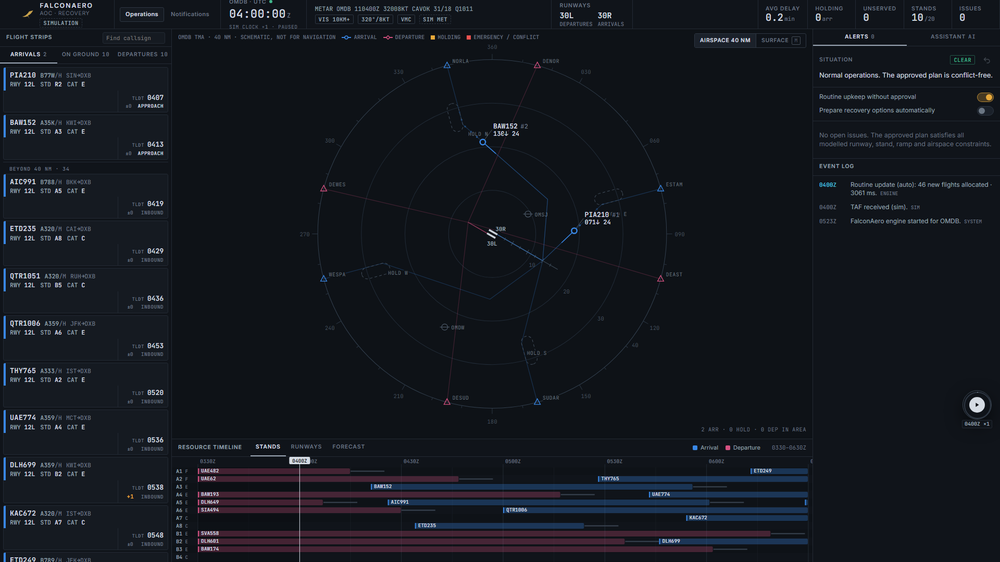
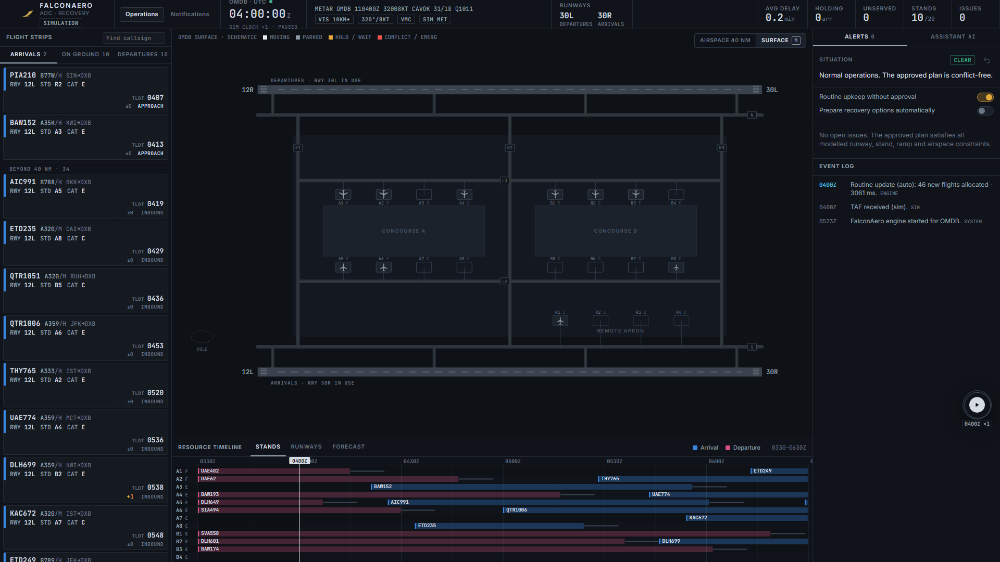
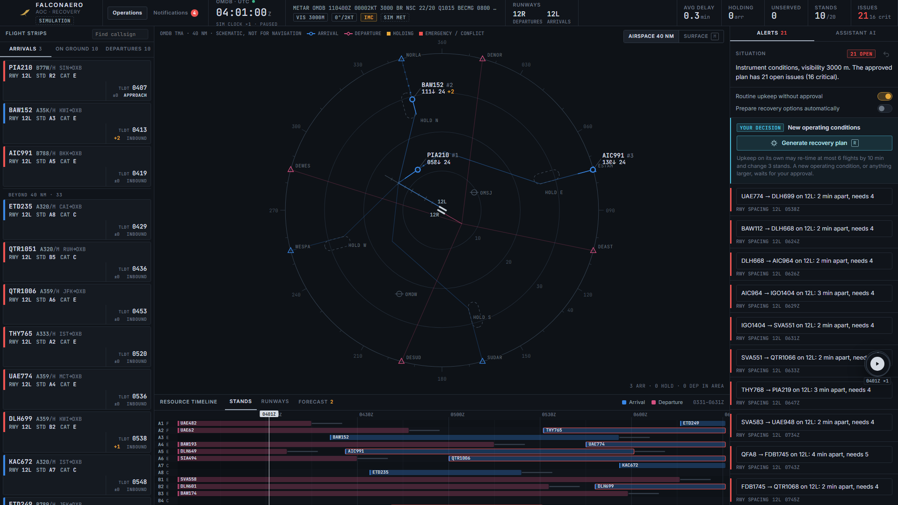
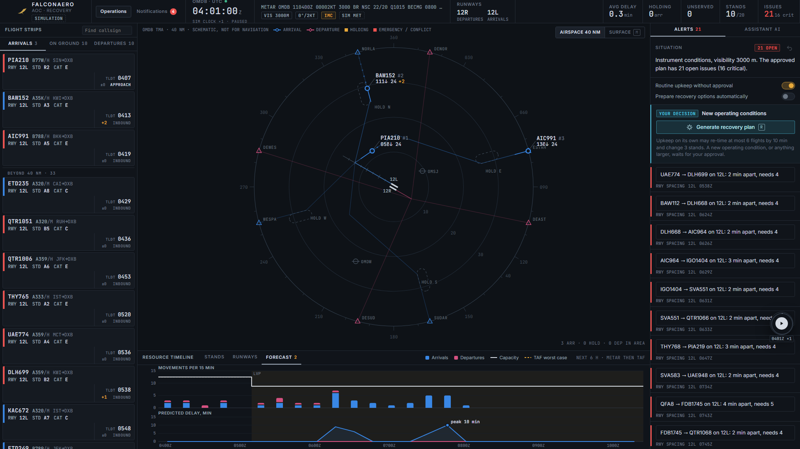
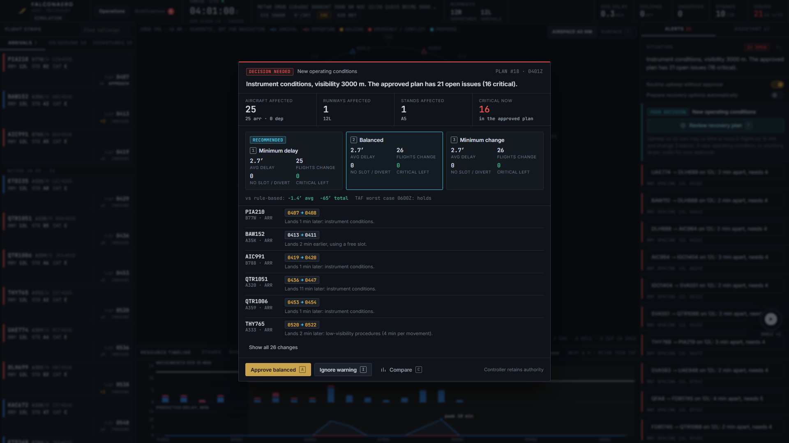
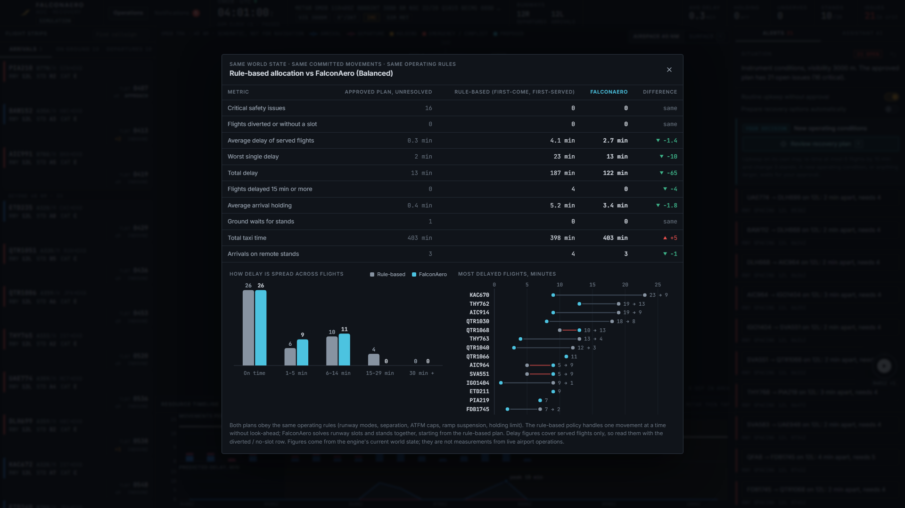
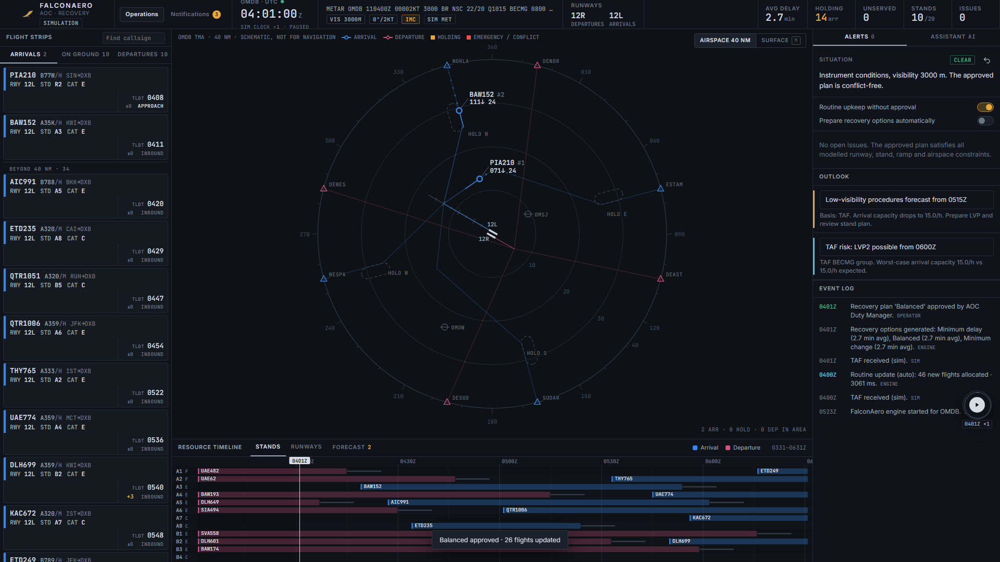
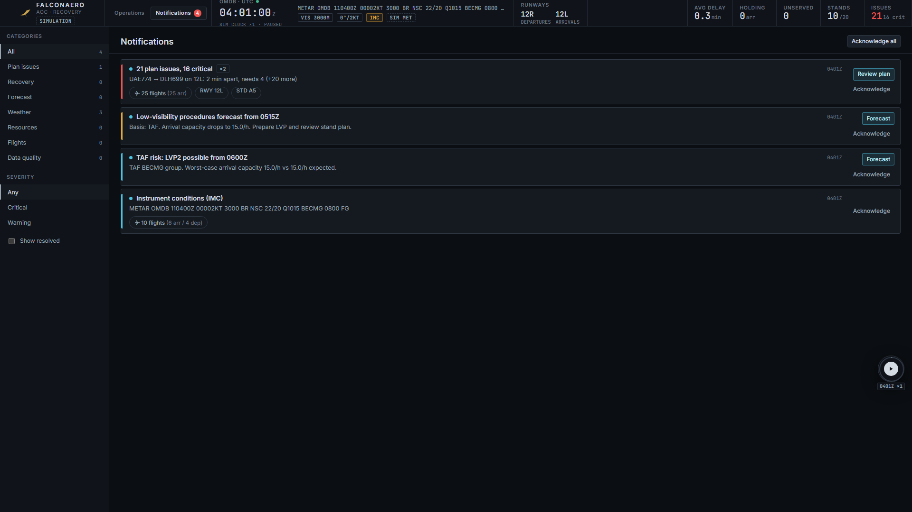
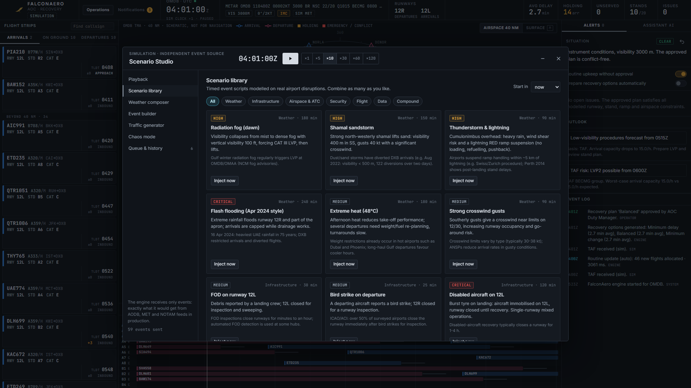

# FalconAero: Intelligent Airport Disruption Recovery

UAE Hackathon 2026 · Youth Track (Pioneers) · Challenge 3 (GCAA) · Team **Falconix**

FalconAero is an **event-driven decision-support engine** for an Airport Operations Centre. It ingests
operational events (schedules, ETAs/TOBTs, METAR/TAF, runway/stand/taxiway status, lightning, ground
stops, ATFM caps, airspace closures, NOTAMs), then:

- **assesses** the current conditions: LVP / CAT II/III, crosswind, runway modes, capacity;
- **validates** the approved plan continuously and raises conflicts;
- **forecasts** demand against capacity for 6 h (METAR nowcast, then TAF, plus a worst-case band) and gives early warnings;
- **re-plans** with OR-Tools CP-SAT (runway slots and stands together, under hard safety constraints,
  emergencies first), next to a rule-based baseline that obeys the same rules;
- **stress-tests** each option against the TAF worst case;
- **notifies** the admin in the Notifications tab;
- **explains** every change, with an optional Groq LLM for briefings, NOTAM parsing and Q&A.

Recovery plans are never applied without approval. Routine upkeep can run automatically within limits
or be switched off in the Alerts panel.

The **simulator is a separate event source**: it only sends events, exactly like a production feed would.
See [docs/ARCHITECTURE.md](docs/ARCHITECTURE.md) for the structure and [docs/DESIGN.md](docs/DESIGN.md)
for the model, its known limits and the questions we expect.

Traffic in the demo is **simulated**. Runway, stand and weather rules are planning assumptions from
public guidance, not certified values.

## Screenshots

Captured from a full demo run of the **Radiation fog (dawn)** scenario on the current build (simulated traffic, OMDB).

**Operations view.** Flight strips, the 40 NM airspace view (schematic), the stand timeline and alerts on one screen.


**Airport surface (`M`).** Runways in use, taxiways and stand occupancy.


**Fog arrives.** METAR drops to 3000 m BR (IMC). The approved plan is re-validated: 21 open issues (16 critical) and a decision is requested.


**Forecast.** Movements per 15 min against capacity (LVP from the TAF) and predicted delay for the next 6 hours.


**Recovery options (`R`).** A pop-up that stays until the controller approves or ignores it: aircraft, runways and stands affected, then Minimum delay, Balanced and Minimum change with the recommended one marked, reasons for every change and a TAF stress test.


**Full comparison (`C`).** Rule-based (first-come, first-served) vs FalconAero under the same rules.


**Approved (`A`).** The plan is logged and can be undone. The outlook keeps watching the forecast.


**Notifications (`N`).** Raised, updated and auto-resolved by the engine, each with the flights, runways and stands it affects.


**Scenario Studio.** 23 scenarios modelled on real events, plus a weather composer, event builder, traffic generator and chaos mode.


### Measured in the fog scenario (Balanced plan vs rule-based, same rules, 6 runs)

Each run starts the same way: 04:00Z with the clock paused, fog injected, one simulated minute, then recovery options ([`video/measure.py`](video/measure.py)).

| Metric | Rule-based (range over 6 runs) | FalconAero Balanced (every run) |
|---|---:|---:|
| Flights without a slot | 0 to 1 (1 in 2 runs) | 0 |
| Average delay of served flights | 2.3 to 7.9 min | 2.7 min |
| Total delay | 105 to 365 min | 122 min |
| Worst single delay | 11 to 40 min | 13 min |
| Flights delayed 15 min or more | 0 to 9 | 0 |
| Critical issues / diverted | 0 / 0 | 0 / 0 |

FalconAero's plan was identical in all six runs. The rule-based plan moves because it starts from the pre-fog allocation, which routine upkeep's time-limited solver produces slightly differently each run. In the two runs where its average delay was lower, it had left a flight without a slot, and average delay only counts served flights. The unrevised plan had 15 to 17 critical issues once the fog arrived. Each option solved in 3.0 s or less and was stress-tested against the TAF LVP2 worst case. The traffic is simulated, so these numbers are not measurements of live airport operations.

The pitch deck is in [`pitch/`](pitch/) (PDF for upload, PPTX with speaker notes).

## Run it (Windows)

```bash
cd backend
python -m venv .venv
.venv\Scripts\python -m pip install -r requirements.txt
copy .env.example .env
.venv\Scripts\python -m uvicorn api.main:app --port 8000
```

Put your Groq key in `backend/.env` (`GROQ_API_KEY=...`). Without it, the AI layer falls back to rules and templates.
`GROQ_MODEL` is optional: if the key cannot use the configured model, the engine picks one it can.
`backend/.env` is in `.gitignore`: leave it out of any zip or upload.

Dashboard, in a second terminal:

```bash
cd frontend
npm install
npm run dev
```

Open http://localhost:5173. For a single-server demo, run `npm run build` and open http://localhost:8000.

Tests (engine is tested only through events):

```bash
cd backend
.venv\Scripts\python -m pytest -q tests
```

## Feeding real data

Every source uses the same endpoint: `POST /api/events` with `{"events": [...]}`.
`GET /api/events/types` returns the JSON schema. Live OMDB weather (NOAA aviationweather.gov) can be
switched on in Scenario Studio → Weather composer.

## Using the simulator

The floating player (bottom right) minimises to a circle and maximises into the **Scenario Studio**:
playback, 23 researched scenarios (fog, shamal, thunderstorm/lightning, Apr-2024-style flooding,
heat, crosswind, FOD, bird strike, disabled aircraft, ILS failure, jet-bridge faults, taxiway works,
Jun-2025-style airspace closure, ATFM, drone, security, medical/full emergency, A380 AOG, bunching,
cancellations, MET feed outage, compound), a METAR composer with live engine preview, an event
builder for every event type, a traffic generator, chaos mode and the event queue.

Shortcuts: `Space` play/pause · `R` review plan · `1/2/3` pick · `C` compare · `A` approve (only when the plan is
current and has no critical issue) · `M` airspace / surface map · `N` notifications · `Esc` close.

The map opens on the **airspace view**: a 40 NM radar-style picture with arrival and departure routes and a data
block per aircraft. Positions are projected from the engine's runway times onto illustrative routes; it is a
schematic, not surveillance data. `M` switches to the airport surface.

While the engine is waiting for your decision the simulation drops to real time, so the plan you are reading stays
current. Pick a speed to override.

## Layout

```
backend/engine/   the product: events, state, rules, planning, optimizer, forecast, notify, llm, feeds
backend/sim/      the simulator: traffic, world executor, scenarios, runner (talks via EngineClient)
backend/api/      FastAPI: /api (engine), /sim (simulator), /api/stream (SSE)
backend/data/airports/omdb.json   data-driven airport definition
frontend/src/     React dashboard (Operations + Notifications tabs, floating sim player)
```
